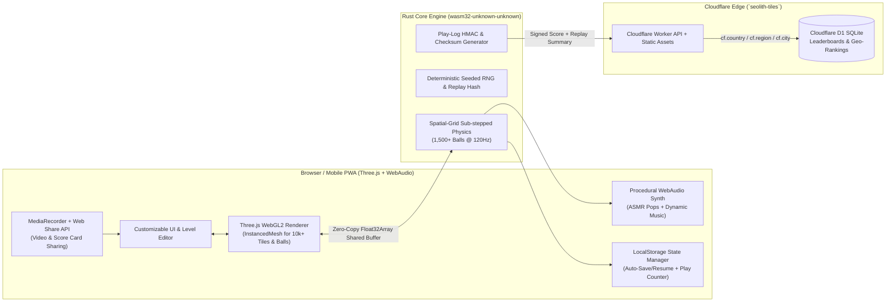

# Seolith Tiles — Architecture & Implementation Plan (`#step001`)

## 1. Deep-Dive Analysis of the X.com Viral "Satisfying Micro-Brick Breaker" Videos

From inspecting both videos ([Post 1: `iwhale/status/2111454912072806784`](https://x.com/iwhale/status/2111454912072806784) and [Post 2: `iwhale/status/2110821987052634247`](https://x.com/iwhale/status/2110821987052634247)), here is what makes this genre hyper-addictive and visually hypnotic:

### Core Gameplay & Physics Loop
1. **High-Density Micro-Tile Vaults**:
   - Instead of 40–60 large bricks, the board is a **dense 2D matrix of 2,000 to 5,000+ micro-tiles** (e.g., `64x64` or `80x80` grid) surrounded by indestructible gray armor walls (`#808080`) with a narrow **breach tunnel / chimney** leading into a hollow chamber inside the vault.
   - Strategic **yellow/gold trigger blocks** sit inside the inner chamber or at tunnel corners.
2. **Aim & Launch**:
   - The player positions the orange paddle at the bottom and aims a dotted trajectory line precisely into the narrow tunnel opening.
3. **The Exponential Cascade ("The Dopamine Loop")**:
   - When the initial ball infiltrates the inner chamber, it bounces rapidly between the tight walls, carving out micro-tiles and releasing falling capsule power-ups:
     - **`x3` (Lime / Cyan Circle)**: Multiplies every active ball currently on screen by 3!
     - **`+3` (Cyan / Green Circle)**: Fires 3 new balls upward from the paddle.
     - **`<->` (Green Expand Capsule)**: Widens the paddle.
     - **`[-]` (Orange Shrink Capsule)**: Shrinks the paddle (hazard).
     - **`★` (Gold Star / Shield)**: Activates a temporary **bottom safety floor** (orange laser barrier across the bottom of the screen) so zero balls can be lost during the chaos!
4. **ASMR Acoustic & Visual Climax**:
   - Going from 1 ball → 3 → 9 → 27 → 81 → 500+ balls trapped inside the micro-tile vault creates an **avalanche of tile destruction** where thousands of tiles disintegrate per second, accompanied by crisp, percussive, pitch-varied ASMR pop/tick sound effects and a 3-star victory fanfare based on clear time.

---

## 2. Technical Architecture (`Rust + WebAssembly + Three.js + Cloudflare`)



### Why Pure Rust `wasm32-unknown-unknown` + Shared TypedArrays + Three.js `InstancedMesh`?
- **Ultra-Lightweight Bundle (<150 KB gzipped)**: By compiling a pure `#![no_std]` / lightweight Rust physics crate directly to `wasm32-unknown-unknown` and exposing flat FFI buffers (`*const f32` for ball positions/colors, `*const u8` for tile states, and event rings for sound triggers), we achieve **zero garbage collection pauses** and **zero serialization overhead** between Rust and JavaScript.
- **60–120 FPS on Mobile with 1,500+ Balls**:
  - Rust handles spatial-grid collision detection (O(1) grid cell lookups for tile collisions + sub-stepped raycast/circle sweeps so balls never tunnel through 1-tile-thick walls).
  - Three.js renders all 5,000+ micro-tiles in **1 single draw call** (`THREE.InstancedMesh`), all 1,500+ balls in **1 single draw call**, and 3D shatter particles in **1 single draw call**—with optional 2.5D/3D camera tilt, neon bloom, and tactile tile extrusion.

---

## 3. Core Feature Pillars

### A. Full Screen, Theme & Level Customization
- **Visual Themes**:
  1. *Classic Viral Vault* (Crimson Red tiles, Slate armor, Sunset Orange paddle, Obsidian background)
  2. *Cyberpunk Neon* (Glowing Cyan/Magenta tiles with bloom)
  3. *Seolith Obsidian & Gold* (Luxury dark stone & gold leaf tiles)
  4. * Emerald Matrix* & *Custom Palette Picker* (customize tile colors, ball trails, 3D tilt angle, grid resolution `40x40` to `80x80`, and aspect ratio for 9:16 mobile portrait or 16:9 desktop).
- **Built-in Level Select + Custom Vault Designer**:
  - Includes iconic viral stages (*"The Diagonal Chimney"* from Post #1, *"The Center Bent Pipe"* from Post #2, *"The Double Helix"*, *"The Hourglass Fortress"*, *"Daily Seeded Vault"*) plus a paintable **Custom Level Editor** where players can draw their own tunnels and share via URL.

### B. Procedural Sound & Dynamic Music (Zero External Audio Bloat)
- **WebAudio API Synthesizer**:
  - **ASMR Tile Pops**: Polyphonic, voice-limited woodblock/marimba/crystal click synthesizer whose pitch scales subtly with combo chains and vertical height (preventing audio clipping when 500 balls hit simultaneously via smart 15ms grain throttling).
  - **Power-up Chimes**: Distinct arpeggiated chimes for `x3`, `+3`, Expand, Shrink, and Safety Star.
  - **Procedural Chiptune / Synthwave Music**: Dynamic background soundtrack generated in real time via WebAudio oscillators that intensifies slightly when ball count exceeds 50.

### C. LocalStorage Auto-Save, Resume & 100-Play Monetization Gate
- **Instant Save & Resume**: Every second (and on `visibilitychange` / page close), the exact Rust engine state (grid tile bytes, active balls, falling capsules, elapsed timer, score, current level) is snapshotted to `localStorage` so players can close the tab and resume mid-avalanche.
- **Monetization Hook After 100 Plays**:
  - Tracks total completed/launched plays (`seolith_play_count`).
  - Plays `1–100`: 100% free, zero friction to maximize viral retention and habit formation.
  - Play `101+`: Activates the **Seolith Pro / Arcade Pass & Rewarded Hook** (configurable supporter pass / Stripe / rewarded ad slot / bonus `x3` starter capsule unlock) with clean UI and server-side/local verification.

### D. Recordable Gameplay & Mobile-First Viral Sharing
- **One-Tap Canvas Video Recorder**: Uses `HTMLCanvasElement.captureStream(60)` + `MediaRecorder` (MP4/WebM) with an automatic **"Last 30s / Full Run Replay"** buffer so players can download or share the exact viral video clip of their cascade!
- **Branded Share Card + Web Share API**: Generates a high-contrast social card image + native `navigator.share` payload (with video/image attachment on iOS/Android) showing Clear Time, Score, Star Rating, Location Rank, and deep link to `seolith-tiles`.

### E. Time & Points Leaderboards (Daily, Weekly, Monthly, Yearly + Geo-Location)
- **Cloudflare D1 + Worker Edge API**:
  - Automatically detects player region via Cloudflare Edge (`request.cf.country`, `request.cf.region`, `request.cf.city`, `request.cf.continent`) with privacy-friendly display (e.g., flag + Country / Region / Global).
  - **Time-Windowed Rankings**:
    - **Daily** (`YYYY-MM-DD`)
    - **Weekly** (`YYYY-Www`)
    - **Monthly** (`YYYY-MM`)
    - **Yearly** (`YYYY`)
    - **All-Time**
  - **Location Scopes**: Global, Country, Region/State, and City toppers ranked by **Fastest Clear Time (ms)** and **Highest Points**.
  - **Security & Anti-Cheat**: Submissions include level ID, clear time, score, ball stats, and a cryptographic proof/plausibility validation (minimum theoretical clear time check + rate limiting + HMAC challenge token).

---

## 4. Proposed Project Structure

```text
seolith-tiles/
├── Cargo.toml                  # Rust WASM physics & game engine crate
├── src-rust/
│   └── lib.rs                  # Spatial grid physics, balls, tiles, capsules, FFI exports
├── public/                     # Static assets & compiled WASM output
│   └── wasm/
│       └── seolith_engine.wasm
├── src/                        # Frontend (Three.js + UI + Audio + Recorder)
│   ├── main.js                 # App bootstrap, game loop, input handlers
│   ├── renderer.js             # Three.js InstancedMesh 3D/2.5D renderer & particles
│   ├── audio.js                # WebAudio ASMR pop synth & procedural music
│   ├── levels.js               # Viral level presets (Post #1, Post #2, etc.) & custom editor
│   ├── storage.js              # LocalStorage save/resume, settings & 100-play monetization
│   ├── recorder.js             # Canvas video recording & mobile Web Share API
│   └── leaderboard.js          # Daily/Weekly/Monthly/Yearly + Geo leaderboard client
├── worker/
│   ├── index.js                # Cloudflare Worker API (Leaderboards, Geo, Anti-cheat, Assets)
│   └── schema.sql              # Cloudflare D1 database schema & indexes
├── scripts/
│   └── consolidate-prompts.mjs # Automated monthly prompt-history consolidation script
├── docs/
│   └── prompts-history/        # Hierarchical YYYY/MM timestamped prompt/response logs
├── index.html                  # Responsive mobile/desktop PWA shell
├── wrangler.toml               # Cloudflare deployment config (`name = "seolith-tiles"`)
└── package.json
```
