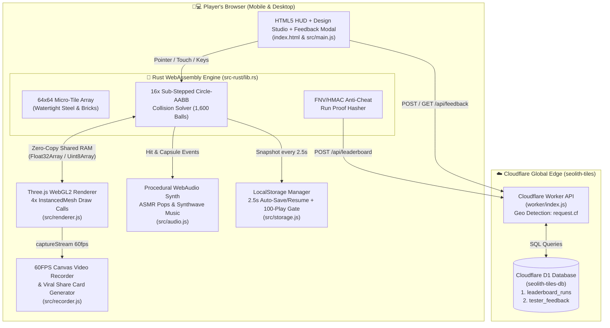
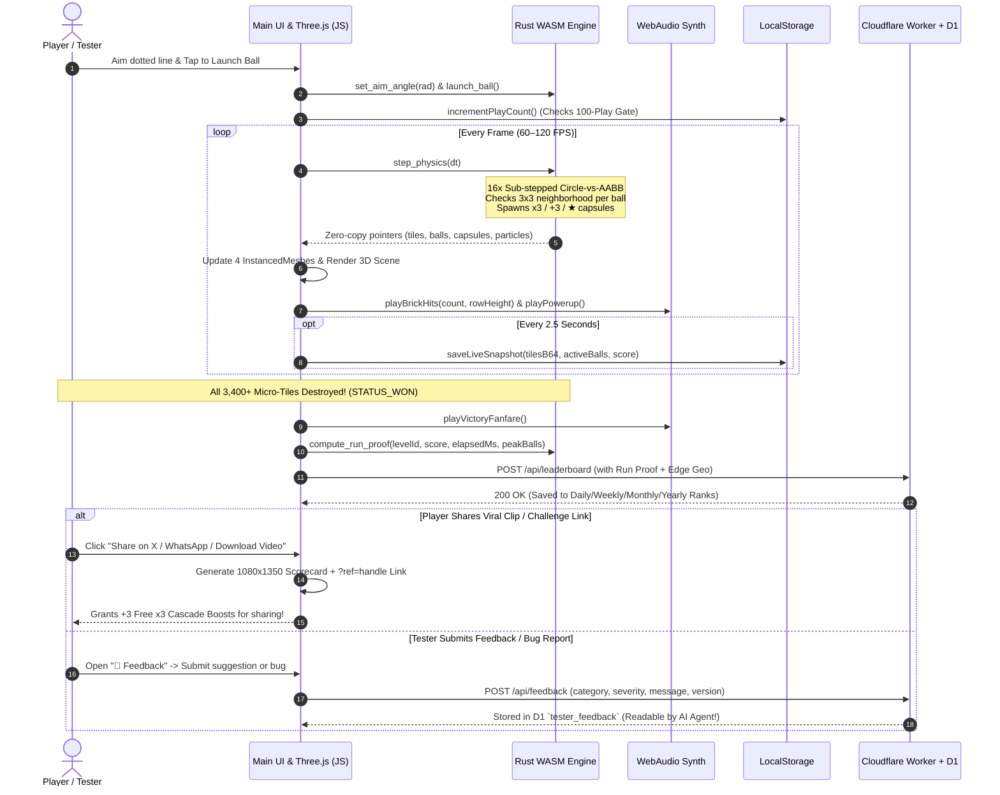

# How We Built **Seolith Tiles**: A Novice Developer's Guide to Rust (WASM), Three.js & Cloudflare Edge

> **Written for Beginner & Curious Developers**: Have you ever watched one of those viral "satisfying brick breaker" videos on X/TikTok where a single ball sneaks up a narrow chimney, hits a yellow block, multiplies into **1,500 bouncing balls**, and shreds **4,000 tiny tiles** in seconds—and wondered: *"How does a browser do all that without freezing?"*
>
> This post walks you through the exact design, physics, architecture diagram, and sequence diagram behind **Seolith Tiles (`v1.1.0`)** in plain, approachable language.

---

## 1. The Big Problem: Why Normal JavaScript Slows Down at 1,500 Balls

If you build a normal web game using standard HTML `
` elements or basic JavaScript objects:
1. **CPU Bottleneck (Physics)**: Checking 1,600 balls against 4,096 bricks every frame means $1,600 \times 4,096 = 6,553,600$ checks *per frame* (nearly **400 million checks per second** at 60 FPS!). Furthermore, fast balls can "tunnel" (bleed) right through thin walls between frames.
2. **GPU Bottleneck (Drawing)**: Asking WebGL to draw 4,096 separate brick meshes and 1,600 ball meshes one by one creates **5,700+ draw calls per frame**, choking mobile phones.
3. **Audio Bottleneck (Sound)**: Playing 500 MP3 audio files at the same millisecond causes loud static distortion and crashes mobile browser audio tabs.

---

## 2. Our 4-Pillar Solution (Explained Simply)

### Pillar 1: Rust + WebAssembly (`src-rust/lib.rs`) — The "Physics Muscle"
Instead of calculating collisions in JavaScript, we wrote the physics engine in **Rust** and compiled it to **WebAssembly (`.wasm`)**—a compact binary format (`154 KB`) that runs at near-native C/Rust speed inside the browser.
- **O(1) Grid Lookup**: Because our vault is a neat grid (e.g., `64×64`), a ball at `(x, y)` doesn't check all 4,096 bricks! It simply divides its `(x, y)` coordinate by the tile size to check **only the 4 to 9 tiles immediately touching it**.
- **Watertight Sub-Stepping & Circle-vs-AABB Collision (`v1.1.0`)**: To prevent balls from bleeding through 1-tile-thick gray steel walls, Rust breaks each frame into up to **16 micro-steps** and uses **Circle-vs-Box (AABB) closest-point math** with priority for steel armor walls.
- **Zero-Copy Shared Memory**: JavaScript doesn't copy arrays back and forth from Rust. Instead, Three.js reads the exact memory bytes (`Uint8Array` and `Float32Array`) directly from WebAssembly's RAM!

### Pillar 2: Three.js `InstancedMesh` (`src/renderer.js`) — The "1-Draw-Call Artist"
Instead of drawing 4,096 tiles one by one, we use `THREE.InstancedMesh`. Think of it like a **rubber stamp**: we upload **one** 3D cube to the graphics card and hand it a list of 4,096 positions and colors. The GPU draws all 4,096 tiles in **1 single step**, all 1,600 balls in **1 step**, and all 1,200 shatter particles in **1 step**!

### Pillar 3: WebAudio Synthesizer (`src/audio.js`) — The "ASMR Sound Designer"
We don't load a single `.mp3` file! Every woodblock pop, crystal chime, and synthwave bass note is generated mathematically using the browser's built-in `AudioContext` oscillators—throttled to ~50 crisp grains per second so 1,500 balls sound like hypnotic ASMR rain rather than loud noise.

### Pillar 4: Cloudflare Worker + D1 SQLite (`worker/index.js`) — The "Global Referee"
When you clear a vault or submit tester feedback, a serverless **Cloudflare Worker** running in 300+ cities worldwide reads your country/city from the network edge (`request.cf`), verifies your anti-cheat cryptographic proof, and saves your rank or bug report into **Cloudflare D1** (edge SQLite).

---

## 3. System Architecture Diagram

---

## 4. End-to-End Gameplay, Viral Share & Feedback Sequence Diagram

---

## 5. How Viral Social Growth & Immediate Monetization Work Together

1. **Challenge Referral Links (`?ref=Handle&level=0&target=42.8`)**:
   - When a player shares on **X (Twitter)**, **WhatsApp**, **Reddit**, or copies their link, the URL carries their handle, level, and clear time.
   - Friends who click the link see a live **"🎯 Challenge Mode: Beat @Handle's 42.8s clear!"** banner at the top of their screen.
   - **Instant Share Reward**: Every time a user shares their run on social media, they immediately receive **+3 Free `⚡ x3 Cascade Boost` credits**, incentivizing organic viral loops on X and TikTok.
2. **Three-Tier Monetization Funnel (Immediate + 100-Play Gate)**:
   - **Tier 1 (Immediate Impulse — `⚡ x3 Boost Pack` & `👑 Seolith Pro Pass`)**: Players don't have to wait 100 plays to support or upgrade—a **👑 Pro / Boosts** button is always accessible in the top bar and when they run out of `x3 Boost` credits.
   - **Tier 2 (Rewarded Sponsor Spot)**: Players can watch a 5-second sponsor spot anytime to refill `+3 x3 Boosts` or unlock `+5 Free Plays`.
   - **Tier 3 (The 100-Play Habit Gate)**: After 100 plays, power users hit the milestone gate converting loyal daily players into lifetime **Seolith Pro Pass** supporters.
